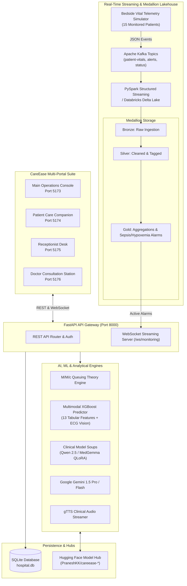

# 🏥 CareEase AI & Integrated Hospital Operations Ecosystem

[](https://www.python.org/)
[](https://fastapi.tiangolo.com/)
[](https://react.dev/)
[](https://vitejs.dev/)
[](https://www.databricks.com/)
[](https://xgboost.readthedocs.io/)
[](https://huggingface.co/PraneshKK)
[](https://huggingface.co/Qwen)
[](https://arxiv.org/abs/2203.05482)
[](LICENSE)

**CareEase AI** (AuraHealth Hospital Ecosystem) is an end-to-end, enterprise-grade healthcare operations and clinical decision-support ecosystem. It unifies real-time OPD queue telemetry (powered by $M/M/c$ queuing theory), AI-driven clinical triage routing, real-time bedside vital telemetry streaming (Kafka + PySpark Medallion Lakehouse), multimodal heart disease and 12-lead ECG risk prediction (XGBoost Vision + Tabular Decision Fusion), bed occupancy forecasting, pharmacy inventory tracking, city-wide inter-hospital interoperability, and specialized clinical LLMs (Qwen 2.5, MedGemma, Google Gemini) fine-tuned with **Model Soups** for zero-latency clinical reasoning.

---

## 🌟 Ecosystem Architecture

CareEase AI is architected as an event-driven, microservices-based ecosystem serving four coordinated clinical roles alongside streaming telemetry pipelines:



---

## 🖥️ The Four Integrated Portals

| Portal Application | Port | Target Users | Key Capabilities |
| :--- | :--- | :--- | :--- |
| **Main Operations Console** (`frontend`) | `5173` | Hospital Administrators, Pharmacists, Kiosks | Executive telemetry dashboard, $M/M/c$ OPD queue wait-time metrics, real-time bed occupancy & surge forecasting, pharmacy inventory & restock alerts, MediKiosk patient self-intake, regional inter-hospital capacity network. |
| **Patient Care Companion** (`patient-app`) | `5174` | Patients, Family & Caregivers | Live OPD token tracking & wait-time estimates, doctor appointment booking, digital e-prescriptions, AI discharge summary assistant, multilingual translation with audio readouts, UPI/card billing QR gateway. |
| **Receptionist Hub** (`receptionist-app`) | `5175` | Front Desk & Triage Receptionists | Rapid patient registration & digital check-in, dynamic bed allocation across general wards & ICUs, department queue routing, attending doctor scheduling, clinical intake audit log. |
| **Doctor Station** (`doctor-app`) | `5176` | Attending Physicians & Specialists | Real-time consultation queue, patient longitudinal history, multimodal XGBoost heart disease & ECG analyzer, live bedside vital telemetry feeds, real-time arrhythmia & sepsis alarms. |

---

## 🚀 Key Functional Capabilities

### 📄 1. AI Hospital Discharge Assistant & Care Companion
- **Multi-Format Ingestion**: Ingests complex discharge summaries and clinical reports from PDF and TXT formats using `pdfplumber` and `pypdf`.
- **Clinical Schema Synthesis**: Extracts diagnoses, active medications, dosage frequencies, dietary restrictions, red-flag emergency symptoms, and follow-up timelines into structured JSON.
- **Multilingual Vernacular Translation**: Translates complex medical jargon into regional languages (Hindi, Tamil, Telugu, Kannada, Bengali, Marathi, Gujarati, Malayalam, etc.) with localized phrasing and Indian Rupee (₹ INR) billing context.
- **Synthesized Audio Readout (TTS)**: Streams real-time MP3 synthesized voice instructions for low-literacy or visually impaired patients via `gTTS`.
- **Grounded Clinical Chat**: Patient Q&A assistant grounded strictly upon the uploaded discharge document with safety disclaimers.

### 🫀 2. Multimodal Heart Disease & ECG Risk Predictor (XGBoost)
- **Dual-Modal Decision Fusion**: Fuses 13 clinical tabular parameters (*Age, Sex, Chest Pain Type, Resting BP, Serum Cholesterol, Fasting Blood Sugar, Resting ECG, Max HR, Exercise Angina, ST Depression, Slope, Major Vessels, Thal*) with 12-lead ECG waveform visual feature extraction.
- **100-Tree ECG Vision Decision Forest**: Custom-trained XGBoost decision forest model analyzing ECG lead waveforms for ST-segment depression, T-wave inversion, and ischemic patterns.
- **Unified Risk Stratification**: Outputs integrated risk percentage, categorical classification (*Low Risk*, *Moderate Risk*, *High Risk Ischemic*), and proactive clinical interventions.
- **Standardized Clinical Presets**: Provides rapid testing profiles (*Normal Profile*, *High-Risk Ischemic Profile*, *Moderate-Risk Arrhythmia Profile*) for clinical validation.

### 🏥 3. OPD Queuing Theory Engine ($M/M/c$) & Smart Triage
- **Analytical $M/M/c$ Queuing Formulation**: Evaluates hourly arrival rate ($\lambda$), physician consultation rate ($\mu$), and active consultation chambers ($c$) to compute doctor utilization ($\rho$), mean wait times ($W_q$), queue lengths ($L_q$), and queue vacancy probability ($P_0$).
- **Smart Clinical Symptom Triage**: Analyzes patient symptom descriptions and maps them to appropriate clinical departments (*Cardiology, Neurology, Orthopedics, Pediatrics, Dermatology, General Medicine*) with urgency levels (*Immediate, Urgent, Standard*).

### 📡 4. Real-Time Bedside Vital Telemetry & Medallion Lakehouse
- **Synthetic Multi-Patient Telemetry Simulator**: Streams continuous physiological vitals (Heart Rate, $\text{SpO}_2$, Systolic/Diastolic BP, Body Temperature, Respiration Rate) across 15 bedside ICU/ER/Ward monitors with realistic biological drift.
- **Dynamic Anomaly Injection**: Provides one-click testing of emergency states (hypoxemia, severe tachycardia, hypertensive crisis, sepsis).
- **Medallion Data Lakehouse (PySpark / Databricks)**:
  - `01_kafka_to_bronze.py`: High-throughput Kafka ingestion into Bronze Delta storage.
  - `02_bronze_to_silver.py`: Signal validation, boundary checks, and clinical status labeling (`NORMAL`, `WARNING`, `CRITICAL`).
  - `03_silver_to_gold.py`: 5-minute sliding-window statistical aggregations and department-level vital trends.
  - `04_patient_alerts.py`: Real-time sepsis, hypoxemia, and tachyarrhythmia threshold alarm dispatcher.
- **WebSocket Gateway & ECG Visualizer**: Instant push telemetry to doctor and staff stations with interactive canvas-based ECG waveform rendering.

### 🛏️ 5. Bed Occupancy & Supply Chain Inventory
- **Real-Time Bed Tracking**: Live capacity monitoring across General Wards, ICU, CCU, Emergency, and Post-Op with predictive surge forecasting.
- **Pharmacy Formulary & Supplies**: Automated stock level tracking, low-inventory notifications, and dispensation audit logs.

### 🌐 6. Inter-Hospital Network & Emergency Dispatch
- **City-Wide Coordination**: Real-time visibility into regional hospital capacities, ICU bed availability, and emergency room loads.
- **Ambulance Dispatch**: Emergency ambulance dispatch management with incoming patient bed reservations.

---

## 🧠 Clinical AI Models & Hugging Face Hub Integration

CareEase AI features native integration with cloud-hosted model repositories on **Hugging Face Hub** with seamless automatic fallbacks to local checkpoints:

### 🤗 Hugging Face Model Repositories
- **XGBoost Tabular & ECG Vision Models**: [`PraneshKK/careease-xgboost-models`](https://huggingface.co/PraneshKK/careease-xgboost-models)
- **Qwen 2.5 Clinical Triage Adapter**: [`PraneshKK/careease-qwen-triage-adapter`](https://huggingface.co/PraneshKK/careease-qwen-triage-adapter)
- **MedGemma Clinical Adapter**: [`PraneshKK/careease-medgemma-adapter`](https://huggingface.co/PraneshKK/careease-medgemma-adapter)

### 🥣 Model Soups (Weight-Averaged LoRA Adapters)
Rather than relying on a single fine-tuned model that risks catastrophic forgetting across distinct medical tasks, CareEase AI implements **Model Souping** (averaging weights across task-specialized checkpoints):
1. **Zero Inference Overhead**: The merged model preserves the exact parameter count, footprint, and inference speed of a standard LoRA adapter.
2. **Task Specialization Ingredients**:
   - **Ingredient A (Triage & Red Flags)**: `data/qwen_soup_triage.jsonl` — Specialized in clinical priority routing and acute emergency symptom classification.
   - **Ingredient B (Discharge & Translation)**: `data/qwen_soup_discharge.jsonl` — Specialized in clinical discharge summarization and patient-friendly multi-lingual instructions.
   - **Ingredient C (ICU & Telemetry)**: `data/qwen_soup_telemetry.jsonl` — Specialized in physiological vital interpretation and telemetry alarm reasoning.
3. **Weight Averaging Formulation**:
   $$W_{\text{soup}} = \frac{1}{K} \sum_{k=1}^K W_k$$
4. **Automated Pipeline Scripts**:
   - `scripts/generate_qwen_datasets.py`: Synthesizes domain-specific clinical datasets.
   - `scripts/train_qwen_soup_models.py`: Executes QLoRA training runs for each clinical task.
   - `scripts/merge_qwen_soup.py`: Performs parameter weight averaging and builds the unified adapter.
   - `scripts/run_qwen_soup_pipeline.bat`: One-click execution of the entire training and souping pipeline.
   - `scripts/upload_models_to_hf.py`: Publishes merged adapters and XGBoost models to Hugging Face Hub.

---

## 📁 Repository Directory Structure

```
Mini-Project/
├── backend/                              # FastAPI Gateway & Operations Microservices
│   ├── app/
│   │   ├── routes/                       # Modular REST API route handlers
│   │   │   ├── ai.py                     # AI clinical routes & assistant endpoints
│   │   │   ├── ambulance.py              # Emergency vehicle dispatch routing
│   │   │   ├── appointments.py           # Appointment booking & scheduling
│   │   │   ├── audit.py                  # Clinical access & change audit logging
│   │   │   ├── auth.py                   # Role-based user authentication & JWT
│   │   │   ├── beds.py                   # Bed allocation & occupancy forecast API
│   │   │   ├── billing.py                # Patient invoicing & QR payment gateway
│   │   │   ├── city_wide.py              # Inter-hospital network coordination API
│   │   │   ├── consultations.py          # Doctor consultation workflow
│   │   │   ├── documents.py              # Discharge document upload & parser
│   │   │   ├── followups.py              # Post-discharge follow-up scheduler
│   │   │   ├── heart_predictor.py        # Multimodal XGBoost Heart Disease & ECG API
│   │   │   ├── intake.py                 # MediKiosk patient digital intake
│   │   │   ├── inventory.py              # Pharmacy & medical supplies API
│   │   │   ├── monitoring.py             # Bedside vital telemetry & streaming
│   │   │   ├── notifications.py          # Patient SMS/WhatsApp alert dispatch
│   │   │   ├── prescriptions.py          # Digital e-Prescriptions management
│   │   │   └── queues.py                 # OPD queues & triage routing API
│   │   ├── services/                     # Core computational & AI service layer
│   │   │   ├── alert_service.py          # Clinical threshold & emergency alerts
│   │   │   ├── heart_disease_model.py    # XGBoost tabular + ECG decision fusion model
│   │   │   ├── llm_service.py            # Multi-provider LLM parser & HF adapter loader
│   │   │   ├── monitoring_service.py     # Real-time telemetry generator & state store
│   │   │   └── tts_service.py            # Text-to-speech audio streaming service
│   │   ├── ai_triage.py                  # Clinical symptom triage classifier
│   │   ├── config.py                     # Environment configuration loader
│   │   ├── database.py                   # SQLite database schema & mock seeder
│   │   ├── main.py                       # FastAPI application entry & WebSocket routes
│   │   └── queue_model.py                # M/M/c Queuing Theory calculation engine
│   ├── streaming/                        # Event-driven streaming subsystem
│   │   ├── kafka_config.py               # Kafka connection & topic parameters
│   │   ├── kafka_consumer.py             # Kafka consumer worker
│   │   ├── kafka_producer.py             # Kafka telemetry producer worker
│   │   ├── schemas.py                    # Pydantic vital schemas & event models
│   │   ├── sensor_simulator.py           # Bedside multi-parameter patient vital generator
│   │   └── spark_streaming.py            # PySpark structured streaming consumer
│   ├── tests/                            # Automated test suite
│   │   ├── test_api.py                   # REST API endpoint unit & integration tests
│   │   └── test_monitoring.py            # Streaming & alert rule test suite
│   ├── requirements.txt                  # Python dependencies
│   ├── hospital.db                       # Active SQLite relational database
│   └── .env.example                      # Environment configuration template
├── frontend/                             # Main Operations & Pharmacy Console (Port 5173)
│   ├── src/
│   │   ├── modules/                      # Admin, Pharmacy, Kiosk, City-Wide modules
│   │   ├── components/                   # Reusable UI components & navigation
│   │   └── index.css                     # Tailwind / Custom responsive stylesheet
│   └── package.json
├── patient-app/                          # Patient Portal & Companion (Port 5174)
│   ├── src/                              # OPD token, appointments, discharge, billing
│   └── package.json
├── receptionist-app/                     # Receptionist & Front Desk Hub (Port 5175)
│   ├── src/                              # Patient check-in, bed reservation, staff ops
│   └── package.json
├── doctor-app/                           # Doctor Consultation Station (Port 5176)
│   ├── src/                              # Consultation workspace, queue, ECG & vital alerts
│   └── package.json
├── databricks/                           # Medallion Lakehouse PySpark Streaming
│   ├── 01_kafka_to_bronze.py             # Kafka ingestion to Bronze Delta table
│   ├── 02_bronze_to_silver.py            # Cleaning, validation & clinical alert flags
│   ├── 03_silver_to_gold.py              # Departmental aggregations & vital trends
│   └── 04_patient_alerts.py              # Emergency threshold alert engine
├── data/                                 # Clinical & Model Soup Datasets
│   ├── medgemma_soup_training_dataset.json # 9,800+ clinical training examples
│   ├── medgemma_clinical_dataset.json    # Clinical triage benchmark samples
│   ├── qwen_soup_triage.jsonl            # Task 1: Clinical triage training samples
│   ├── qwen_soup_discharge.jsonl         # Task 2: Discharge summary training samples
│   ├── qwen_soup_telemetry.jsonl         # Task 3: ICU vital telemetry training samples
│   └── qwen_soup_master_dataset.jsonl    # Combined clinical dataset
├── scripts/                              # Training, Souping & HF Deployment Tools
│   ├── generate_qwen_datasets.py         # Synthesizes clinical soup datasets
│   ├── train_qwen_soup_models.py         # QLoRA training for Qwen soup components
│   ├── merge_qwen_soup.py                # Model soup weight averaging for Qwen
│   ├── run_qwen_soup_pipeline.bat        # Batch runner for full Qwen soup pipeline
│   ├── fine_tune_medgemma.py             # QLoRA fine-tuning for MedGemma
│   ├── train_medgemma_lora.py            # LoRA training runs for Gemma
│   ├── merge_medgemma_soup.py            # Weight averaging tool for MedGemma
│   ├── upload_models_to_hf.py            # Uploads XGBoost models & adapters to HF Hub
│   ├── start_simulator.py                # Standalone bedside vital telemetry simulator
│   └── create_medgemma_model.bat         # Batch script for Ollama model build
├── xgboost_tabular_model.json            # Trained XGBoost tabular clinical risk model
├── xgboost_ecg_model.json                # Trained XGBoost 100-tree ECG vision model
├── Modelfile                             # Ollama Modelfile for clinical assistant
├── Modelfile.qwen_soup                   # Ollama Modelfile for Qwen model soup
├── soup.yaml                             # Model Soup training recipe for MedGemma
├── soup_qwen.yaml                        # Model Soup training recipe for Qwen
├── docker-compose.yml                    # Kafka & Zookeeper container configuration
├── run.bat                               # One-click startup script for all 4 apps + backend
├── run_all_monitoring.bat                # Startup script with streaming telemetry & simulator
├── STREAMING_README.md                   # Real-time streaming pipeline documentation
└── README.md                             # Project documentation
```

---

## ⚡ Quick Start & Execution

### Prerequisites
- **Python**: `3.10` or higher
- **Node.js**: `18.x` or higher (`npm` included)
- **Git**
- *(Optional)* **Docker Desktop** (if running local Kafka/Zookeeper)

---

### 🚀 One-Click Multi-Service Launch (Windows)

Launch the entire ecosystem with a single command:
```bat
run.bat
```
This automatically starts:
1. **FastAPI Gateway**: `http://127.0.0.1:8000` (Interactive Swagger Docs: `http://127.0.0.1:8000/docs`)
2. **Main Operations Console**: `http://localhost:5173`
3. **Patient Care Companion**: `http://localhost:5174`
4. **Receptionist Desk**: `http://localhost:5175`
5. **Doctor Station**: `http://localhost:5176`

To launch with continuous bedside vital monitoring & background telemetry simulator active:
```bat
run_all_monitoring.bat
```

---

### 🛠️ Manual Step-by-Step Setup

#### 1. Backend API Gateway Setup
```bash
cd backend
python -m venv venv

# Windows
.\venv\Scripts\activate
# Linux / macOS
source venv/bin/activate

pip install -r requirements.txt
cp .env.example .env
```

Configure `backend/.env` with your settings (see [Environment Configuration](#-environment-configuration)).

Start the FastAPI application:
```bash
python -m uvicorn app.main:app --reload --host 127.0.0.1 --port 8000
```

#### 2. Frontend Applications Setup
Open separate terminal tabs for each portal application:

```bash
# Terminal 1: Main Operations Console (Port 5173)
cd frontend
npm install
npm run dev

# Terminal 2: Patient Care Companion (Port 5174)
cd patient-app
npm install
npm run dev

# Terminal 3: Receptionist Hub (Port 5175)
cd receptionist-app
npm install
npm run dev

# Terminal 4: Doctor Station (Port 5176)
cd doctor-app
npm install
npm run dev
```

#### 3. (Optional) Apache Kafka & PySpark Streaming
If running in Kafka streaming mode:
```bash
# Start Kafka & Zookeeper containers
docker-compose up -d

# Start PySpark streaming pipeline
python backend/streaming/spark_streaming.py
```
*(Note: If Docker/Kafka is not running, the system automatically falls back to internal simulation mode with zero setup required).*

---

## ⚙️ Environment Configuration

Create a `.env` file in the `backend/` directory by copying `.env.example`:

| Environment Variable | Default Value | Description |
| :--- | :--- | :--- |
| `LLM_PROVIDER` | `gemini` | Clinical LLM engine (`gemini`, `qwen`, `qwen-local-ft`, or `medgemma`). |
| `GEMINI_API_KEY` | *None* | Google Gemini API Key (required if `LLM_PROVIDER=gemini`). |
| `QWEN_API_BASE` | `http://localhost:11434/v1` | Ollama API endpoint for local Qwen 2.5 execution. |
| `QWEN_MODEL_NAME` | `qwen2.5:14b` | Ollama model identifier. |
| `LOCAL_FT_BASE_MODEL` | `Qwen/Qwen2.5-1.5B-Instruct` | Base model for local fine-tuned QLoRA adapter loading. |
| `HF_TOKEN` | *None* | Hugging Face Access Token for downloading private models. |
| `HF_XGBOOST_REPO` | `PraneshKK/careease-xgboost-models` | Hugging Face Hub repository for XGBoost models. |
| `HF_QWEN_ADAPTER_REPO` | `PraneshKK/careease-qwen-triage-adapter` | Hugging Face Hub repository for Qwen triage adapter. |
| `HF_MEDGEMMA_ADAPTER_REPO` | `PraneshKK/careease-medgemma-adapter` | Hugging Face Hub repository for MedGemma adapter. |
| `STREAMING_MODE` | `simulation` | Telemetry mode (`simulation` or `kafka`). |
| `MONITORING_INTERVAL_SECONDS`| `2` | Bedside telemetry broadcast interval in seconds. |
| `KAFKA_BOOTSTRAP_SERVERS` | `localhost:9092` | Apache Kafka broker address. |
| `PORT` | `8000` | Backend API Gateway port. |
| `HOST` | `127.0.0.1` | Backend API Gateway host binding. |

---

## 📡 Complete API Reference

### 📄 Clinical AI & Discharge Assistant
| Method | Endpoint | Description |
| :--- | :--- | :--- |
| `POST` | `/api/upload` | Uploads and extracts PDF/TXT medical discharge summaries into validated JSON. |
| `POST` | `/api/explain` | Translates medical instructions into regional languages (Hindi, Tamil, Telugu, etc.). |
| `POST` | `/api/chat` | Grounded clinical Q&A companion based on patient discharge records. |
| `GET` | `/api/tts` | Streams real-time synthesized MP3 audio instructions. |
| `POST` | `/api/ai/triage` | Analyzes patient clinical symptoms and predicts priority specialty. |

### 🫀 Multimodal Heart Disease & ECG Prediction
| Method | Endpoint | Description |
| :--- | :--- | :--- |
| `POST` | `/api/predict/heart-disease` | Multi-modal XGBoost Heart Disease risk prediction (13 tabular features + 12-lead ECG waveform upload). |
| `GET` | `/api/predict/heart-disease/presets` | Retrieves clinical validation test profiles (*Normal*, *High-Risk Ischemic*, *Moderate Arrhythmia*). |

### 🏥 OPD Queues & $M/M/c$ Telemetry
| Method | Endpoint | Description |
| :--- | :--- | :--- |
| `GET` | `/api/queues/status` | Dynamic $M/M/c$ queuing theory metrics (arrival rate $\lambda$, service rate $\mu$, doctor utilization $\rho$, wait times $W_q$). |
| `GET` | `/api/queues/list` | Returns active patient tokens per department. |
| `POST` | `/api/queues/token/generate` | Generates a new OPD queue token with estimated consult time. |
| `POST` | `/api/queues/token/{id}/advance` | Advances queue token status (waiting, in-consultation, completed). |

### 📡 Bedside Vital Monitoring & Real-Time Alerts
| Method | Endpoint | Description |
| :--- | :--- | :--- |
| `GET` | `/api/monitoring/patients` | Retrieves current vitals for all 15 monitored bedside patient monitors. |
| `GET` | `/api/monitoring/patients/{patient_id}` | Detailed telemetry profile for a specific patient. |
| `GET` | `/api/monitoring/alerts` | Active and historical clinical threshold alarms feed. |
| `POST` | `/api/monitoring/simulator/start` | Starts background vital telemetry generation loop. |
| `POST` | `/api/monitoring/simulator/stop` | Pauses background vital telemetry generation loop. |
| `POST` | `/api/monitoring/simulator/patient/{patient_id}/critical` | Injects synthetic critical emergency state (hypoxemia/tachycardia) for stress testing. |
| `WS` | `/ws/monitoring` | Real-time WebSocket connection for streaming patient vitals & alert broadcasts. |

### 🛏️ Bed Management & Surge Forecasting
| Method | Endpoint | Description |
| :--- | :--- | :--- |
| `GET` | `/api/beds/status` | Current departmental bed occupancy counts and utilization percentages. |
| `GET` | `/api/beds/forecast` | Predictive 7-day bed surge forecast based on admission trends. |
| `POST` | `/api/beds/allocate` | Assigns patient to an available bed in a designated ward. |
| `POST` | `/api/beds/release` | Discharges patient and marks bed for sanitation. |

### 💊 Pharmacy & Inventory
| Method | Endpoint | Description |
| :--- | :--- | :--- |
| `GET` | `/api/inventory/list` | Real-time pharmacy stock counts, batch numbers, and reorder alerts. |
| `POST` | `/api/inventory/dispense` | Records medication dispensation against patient prescription. |
| `GET` | `/api/inventory/dispensations` | Full audit log of historical drug dispensations. |

### 🌐 Inter-Hospital Network & Ambulance Dispatch
| Method | Endpoint | Description |
| :--- | :--- | :--- |
| `GET` | `/api/city-wide/beds` | Regional partner hospital bed availability (ICU, General, Emergency). |
| `GET` | `/api/city-wide/queues` | Cross-hospital emergency room load and wait times. |
| `GET` | `/api/city-wide/emergency-status`| Regional disaster & trauma center operational status. |
| `POST` | `/api/ambulance/dispatch` | Dispatches emergency vehicle and coordinates destination hospital intake. |

### 🩺 Consultations, Appointments & Intake
| Method | Endpoint | Description |
| :--- | :--- | :--- |
| `POST` | `/api/intake/submit` | Digital patient self-registration via MediKiosk. |
| `GET` | `/api/consultations/active` | Current doctor consultation session data. |
| `POST` | `/api/consultations/complete` | Concludes consultation, commits clinical notes, and generates prescription. |
| `GET` | `/api/appointments/list` | Booked patient appointments filterable by date and doctor. |
| `POST` | `/api/appointments/book` | Schedules a new OPD appointment. |
| `GET` | `/api/prescriptions/patient/{id}`| Retrieves digital e-prescriptions for a patient. |
| `POST` | `/api/billing/invoice` | Generates patient itemized invoice with UPI payment QR. |
| `GET` | `/api/audit/logs` | Security and operational compliance audit trail. |

---

## 🧪 Testing & Verification

Run the automated backend test suite to verify all APIs, queuing calculations, and streaming simulation:

```bash
cd backend
python -m unittest tests/test_api.py
python -m unittest tests/test_monitoring.py
```

---

## 🤝 Contributing

Contributions are welcome! Please follow these steps:
1. Fork the repository.
2. Create your feature branch (`git checkout -b feature/AmazingCareEaseFeature`).
3. Commit your changes (`git commit -m 'feat: Add AmazingCareEaseFeature'`).
4. Push to the branch (`git push origin feature/AmazingCareEaseFeature`).
5. Open a Pull Request.

---

## 📄 License

Distributed under the MIT License. See [LICENSE](file:///d:/Projects/Mini%20Project/Mini-Project/LICENSE) for full details.

<p align="center">
  Crafted with ❤️ for healthcare innovation, clinical excellence, and patient well-being.
</p>
